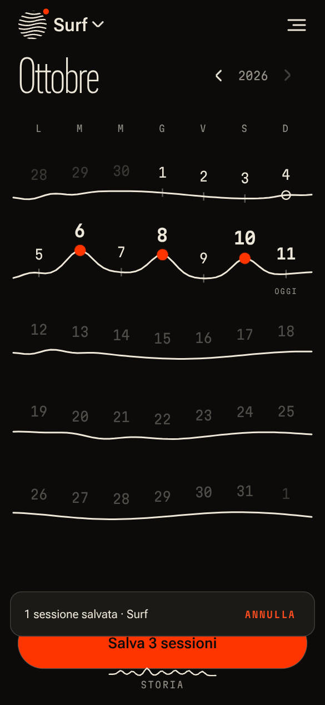
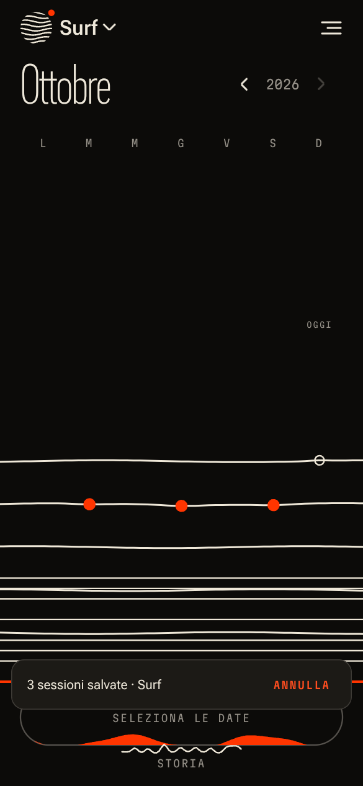
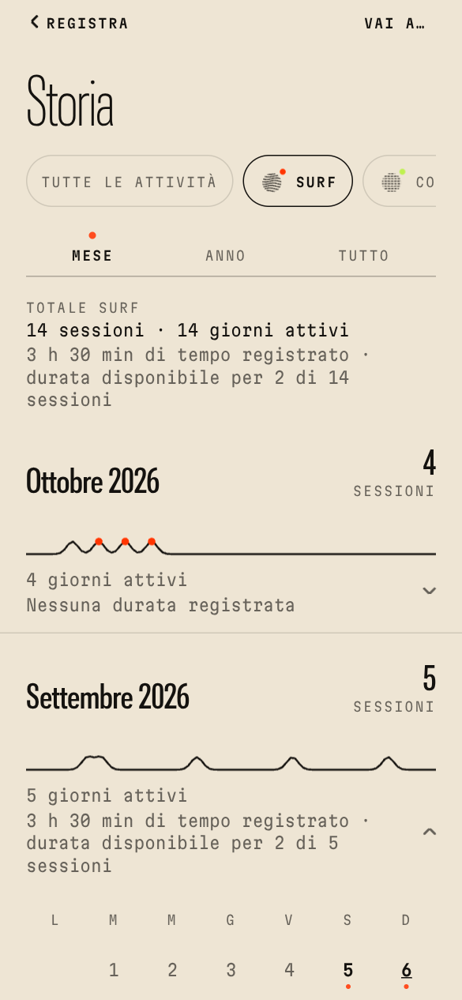
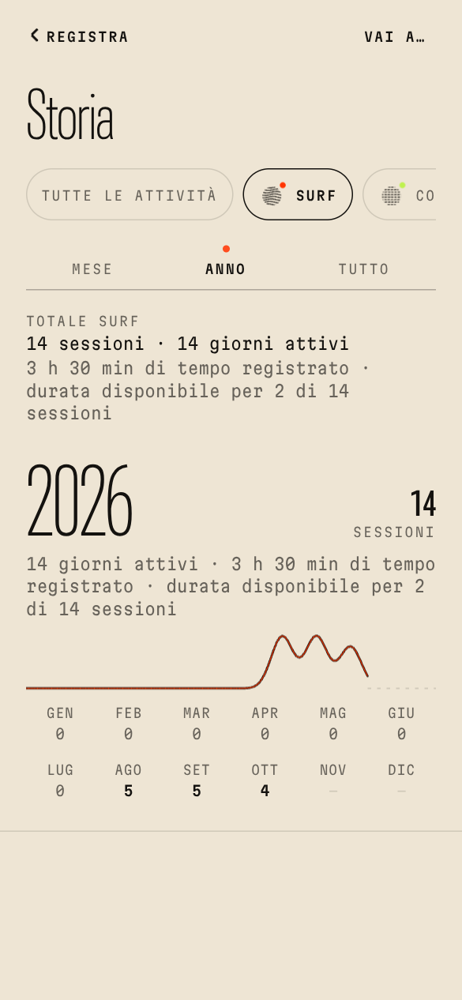

# Serie

**A motion-first activity log for iPhone.** Every week is a swell line, every session is a crest on it, and saving makes the lines break like a wave. Serie opens straight into the activity you used last (Surf on first launch): you tap the dates, tap **Salva**, and your personal history grows on the same lines.

The visual identity, motion grammar, typography and palette come from the *corduroy* trailer in `../trailer` (rendered in `../deliverables`). App language: **Italian**.

| Lineup | Save → breaking wave | Switch activity | History (Mese) |
|---|---|---|---|
|  |  |  |  |

| Year | Progress (Tutto) | Session details | Calendar import review |
|---|---|---|---|
|  |  |  |  |

Screens come from the web verification build (headless Chromium, 390 × 844 pt). They are not iPhone screenshots: see the [status matrix](#status).

---

## What it does

- **Immediate entry.** Launch → the living calendar of the remembered activity, ready for date selection. The remembered activity survives restarts. If it was deleted, Serie falls back safely and says so.
- **Moment A — switching activity.** Tap the identity disc: the week-lines rise into an arc of activity discs. The chosen disc flows into the header and recolours the lines with its own pattern (swell, stride, pulse, drift, ripple, grain).
- **Moment B — selecting dates.** Each tap lifts the week-line into a crest (spring water simulated on the UI thread), the liquid in Save rises, and future dates are refused. Months swipe like a passing swell.
- **Moment C — saving.** One idempotent transaction, *then* the break: the lines curl into a wave, the dots ride the lip into the history handle, and the saved days settle as rings. **Annulla** undoes it for a few seconds. A double tap can't duplicate a save, while a deliberate second session on the same day is allowed.
- **History.** *Mese* (multi-year scroll, collapsible mini calendars, several sessions per day, day totals), *Anno* (annual totals, month drill-down) and *Tutto* (totals, a summary for any period, trend, frequency over complete weeks/months, consistency, distribution, milestones), plus *Vai a…* jumps to any month and year.
- **Honest numbers.** Session count, active days and recorded hours are kept separate. Unknown durations stay unknown: never 0, never 24 h. Duration coverage is always shown ("durata disponibile per 2 di 4 sessioni").
- **Optional details per session.** Place, address, Google Maps link (parsed, short links resolved, map preview on iOS, manual pin) and notes. Four timing states: date only, start only, start–end (explicit next-day end), duration only, plus start + duration. DST-correct.
- **Activities.** Create, rename, recolour, change pattern, reorder and delete, with safeguards: move sessions elsewhere, or delete them after two confirmations.
- **Calendar exchange** (Google Calendar via OAuth, iPhone calendars via EventKit):
  - **Import** into one activity. Source calendars, date range (complete multi-year paging), title-only "contiene" filter and Google colour labels. A review list shows statuses (new / already imported / possible match / cancelled), scoped select-all and accurate counts.
  - **Export** one activity to Google, iPhone or both. "Both" is blocked when it would be the same calendar twice. Prefix/suffix previews, per-event outgoing edits, explicit "apply to session", and duplicate checks against the real calendar. Idempotent retries, with results per destination.
  - **Automatic export** after saving: off by default. It waits until **Annulla** can no longer undo the save. Jobs persist, retry with backoff, and wait in "Da rivedere" when a decision is needed. They can be cancelled when automatic export is turned off. The **Esportazioni in sospeso** screen shows each job's real state.
- **Offline first.** Everything is stored in SQLite on the device. Calendars are only touched when you use those features.

Architecture, motion grammar and integrity rules: [`ARCHITECTURE.md`](ARCHITECTURE.md). Full brief: [`docs/SPEC.md`](docs/SPEC.md).

---

## Run it

Requirements: **Node 22.13+** and npm. For iOS builds, an Expo account (free) and an Apple Developer account. A Mac with **Xcode 26.4+** is needed only for local builds.

```bash
cd serie
npm install            # also copies the web wasm runtimes into public/ (postinstall)
```

### On an iPhone (development build — recommended)

Serie uses native modules (Skia, Reanimated worklets, SQLite, EventKit, Apple Maps, SecureStore), so it does **not** run in Expo Go. Build a development client once, then iterate with the bundler:

```bash
npx eas-cli@latest login
npx eas-cli@latest init                       # links the project (writes extra.eas.projectId)
npx eas-cli@latest device:create              # register your iPhone (ad hoc provisioning)
npx eas-cli@latest build --profile development --platform ios
# install the build from the QR/link EAS prints, then:
npx expo start --dev-client
```

iOS Simulator instead of a device: `npx eas-cli@latest build --profile development-simulator --platform ios`.

Local alternative on a Mac: `npx expo run:ios` (simulator) or `npx expo run:ios --device`. This generates `ios/` with Continuous Native Generation; don't edit `ios/` by hand.

Open it in Xcode instead: `tools/open-in-xcode.sh` checks Xcode 26.4+, Node and CocoaPods, generates `ios/`, installs the pods, switches Run to Release (JS bundle embedded, no Metro needed) and opens the workspace. Pick a simulator and press Run.

No local build at all: `.github/workflows/ios-simulator.yml` (**Actions → "iOS Simulator (build + smoke test)"**, about 15 macOS minutes) builds `Serie.app` for the Simulator and uploads it as an artifact; drag it onto the Simulator window. The same run executes the native smoke test in `maestro/` (launch, save, restart, history, activity switch, place + Apple Maps, export to the simulator's own iPhone calendar) through `tools/sim-smoke.sh`, with a screen recording, screenshots and the app log.

### TestFlight / App Store

1. Create the app in App Store Connect with bundle id **`app.serie.ios`** (or change `ios.bundleIdentifier` in `app.json`).
2. `npx eas-cli@latest build --profile production --platform ios` (the build number auto-increments).
3. `npx eas-cli@latest submit --platform ios --latest`, then add testers in TestFlight.

Google Calendar uses sensitive scopes: users outside the OAuth test-user list need Google's app verification first (see below).

### Sideload with SideStore / AltStore (no paid Apple account)

The repository has a GitHub Actions workflow that builds an **unsigned** IPA on a macOS runner: `.github/workflows/ios-ipa.yml`. Start it from **Actions → "iOS IPA (unsigned, sideload)" → Run workflow**. It runs only on demand, because macOS minutes in a private repo are limited.

- Build 1 took about 6 minutes (`macos-26`, Xcode 26.6). Output: prerelease `ipa-<n>` with `Serie-unsigned.ipa` and its `.sha256`, plus a 7-day artifact.
- The IPA is unsigned. SideStore or **AltStore Classic** (not AltStore PAL) re-sign it with your Apple ID and change the bundle id to `app.serie.ios.<TEAMID>`.
- iPhone with **iOS 16.4+** and Developer Mode on. The place map needs iOS 17; iOS 16 shows the text readout.
- With a free Apple ID the app expires after 7 days (SideStore/AltStore refresh it) and uses 1 of 3 active app slots and 1 of 10 weekly App IDs.
- The repository is private, so download the release asset in Safari while signed in to github.com, then share it to SideStore/AltStore.
- Google Calendar is enabled only if the repository variable (or secret) `EXPO_PUBLIC_GOOGLE_IOS_CLIENT_ID` is set before the build. On a re-signed app, Google sign-in is best-effort because the bundle id changes. iPhone calendars always work.

### Web (verification build only)

```bash
npm run web            # dev server; Skia runs on CanvasKit, SQLite on sql.js (IndexedDB)
npm run build:web      # static bundle in dist-web/
```

The web build exists to verify the UI and data layer in CI-like environments. Calendars are unavailable on web, because EventKit is iOS-only and the Google web client is optional.

---

## Configuration

| Variable | Needed for | Notes |
|---|---|---|
| `EXPO_PUBLIC_GOOGLE_IOS_CLIENT_ID` | Google Calendar on iOS | An iOS OAuth client id (`NNNN-xxxx.apps.googleusercontent.com`). It is not a secret, and no client secret is used. `app.config.ts` registers its reversed form as a URL scheme. |
| `EXPO_PUBLIC_GOOGLE_WEB_CLIENT_ID` | optional, web verification of Google | Web OAuth client with origin `http://localhost:8081`. |
| `EXPO_PUBLIC_SERIE_E2E_CALENDAR` | **tests only** | `1` replaces both providers with in-memory test calendars (`src/calendar/memory.ts`). Never set it for real builds. |

Put them in `.env` (local) or in EAS environment variables (`npx eas-cli@latest env:create`), and rebuild after changing them.

**Google Cloud setup (once).** Enable the Google Calendar API, configure the consent screen (External, add test users while in *Testing*), and add the scopes `openid`, `userinfo.email`, `calendar.readonly` and `calendar.events`. Then create an **iOS** client for bundle id `app.serie.ios`. In *Testing*, refresh tokens expire after 7 days; production needs Google verification for the sensitive scopes. Details: [`src/calendar/google/README.md`](src/calendar/google/README.md).

**iPhone calendars.** No setup beyond the development build. The `expo-calendar` config plugin writes the permission text. iOS 17+ asks for full access, which import and duplicate checks need. If the user grants write-only access, Serie says that it can't check duplicates or import. Details: [`src/calendar/apple/README.md`](src/calendar/apple/README.md).

**Permissions** are requested only when the matching feature is used (calendar on *Collega*, clipboard on paste). Location is never requested.

---

## Verify

```bash
npm run typecheck      # tsc --noEmit
npm run lint           # expo lint (eslint-config-expo)
npm test               # Jest: domain, data (sql.js), state, calendar engines, providers (fakes), maps, sheets helpers
npm run e2e            # web builds + three headless-Chromium suites (Playwright, Chromium preinstalled)
```

The e2e suites drive the real UI and assert on what a user sees:

- `tools/e2e.mjs`: first launch in Surf, multi-date save, restart persistence, stale selections not reused, double-tap protection, same-day sessions, future dates, switching persistence, Month/Year/All history.
- `tools/e2e-flows.mjs`: the **statistics acceptance test** (date-only, start-only 08:00, 09:00–11:00 and 1.5 h give 4 sessions, 3 h 30 min, 2 of 4), edit and delete updating totals, one duration applied to several dates, details not reused, activity create and duplicate name, deleting the remembered activity, month jump, reduced motion, Google Maps links (refused vs resolved, link kept verbatim), and the "unsaved edits" guard.
- `tools/e2e-calendar.mjs` (against the in-memory test calendars): title-only filter, labels, recurring occurrences without the cancelled one, multi-day mapping, scoped selection, re-import recognition, the equivalent "both" destinations being blocked, export, idempotent re-export, differences offered as explicit updates, and automatic export after a save.

---

## Status

What was actually checked, and how. Nothing here was run on an iPhone: this repository was built in a Linux container without Xcode, a device or Google credentials.

### Implemented and verified

| Area | Verified by |
|---|---|
| Domain rules: dates, DST-correct zoned time, the four timing states (plus start + duration), duration parsing (`1,5` · `1:30` · `90 min` · `1 ora e 30`), honest statistics, milestones, history grouping | Jest (`src/domain`), including the statistics acceptance test |
| Persistence: migrations, repositories, idempotent saves (double tap ≠ duplicate, deliberate same-day session allowed), category delete/move safeguards, fallback when the remembered activity is deleted | Jest on sql.js (same SQL as the device), plus a native-driver test with a fake `expo-sqlite`: one connection, foreign keys on, serialised `BEGIN IMMEDIATE` transactions |
| Signature journey on the web build: launch in Surf, multi-date save, persistence after restart, switching activity, Month/Year/All history, details, edit/delete updating totals, reduced motion | `tools/e2e.mjs` (10 checks) and `tools/e2e-flows.mjs` (11 checks), headless Chromium |
| Calendar import, export and automatic export: UI, engines and the local database together | `tools/e2e-calendar.mjs` (9 checks) against the in-memory **test** calendars, plus Jest for the engines and both providers (with a fetch mock for Google and a fake EventKit for Apple) |
| Native configuration: Italian localization, dark UI, calendar permission text (iOS 16 + 17), no location permission, encryption flag, Google URL scheme, registered fonts, splash | `expo prebuild --platform ios` in a scratch copy (generated `Info.plist` inspected) and `expo-doctor` (21/21) |
| Type safety and lint | `tsc --noEmit` and `expo lint`: 0 errors |
| Adversarial review | 5 independent review dimensions, each checked by a skeptic: 67 confirmed findings, all fixed and re-verified by the suites above |

Totals at the last run: **777 unit tests in 38 suites**, **30 e2e checks**, 0 type errors, 0 lint problems.

### Implemented, not verified on a device

- Skia rendering on the iPhone GPU and Reanimated worklets on the UI thread. Frame rate and memory were **not measured**. The web build runs Skia on CanvasKit/SwiftShader, which says nothing about iPhone performance.
- Haptics, the iOS form sheets, keyboard insets, VoiceOver announcements, Dynamic Type and the Apple Maps preview (iOS 17+; iOS 16 shows the text readout).
- The `expo-sqlite` driver on a device (unit-tested against a fake only).
- iPhone calendars (EventKit): permissions, reading and writing. Tested against a fake EventKit only.
- Google Calendar: OAuth and the REST calls. Tested against a fetch mock only; **no real calendar was read or written**.
- The `serie://export?m=…` link opening the exported session from Apple Calendar (unit-tested redirect only).

### Needs external setup (not possible in this environment)

- **iOS builds:** an Expo account plus an Apple Developer account for EAS Build/TestFlight, or a Mac with Xcode 26.4+.
- **Google Calendar:** a Google Cloud project with an iOS OAuth client (`EXPO_PUBLIC_GOOGLE_IOS_CLIENT_ID`), test users, and Google verification of the sensitive scopes before a public release.

### Known limitations (documented, not hidden)

- EventKit reports an event's time zone only as an abbreviation, so imported iPhone events show wall times in the device zone. The instant is still correct.
- Google: if Google's search index lags right after an uncertain write, the reconciliation may not find Serie's event. It is then recognised later through its metadata ("Evento riconosciuto"), but a duplicate is possible in that narrow window.
- For start-only sessions, the event metadata cannot distinguish an approved scheduling span from a calendar-only time, so re-import keeps the event's start time.
- Re-importing an event whose session was deleted keeps the original title and span from the first import.
- A place name read from a resolved short Maps link survives a later link change; the user can still edit it.
- Automatic export runs while the app is open (after the undo window, on foreground, on network return, every minute). There is no background task. Jobs persist and resume on the next launch.
- Turning automatic export off with "Mantienile" lets already-queued jobs finish (the UI says so); "Annulla quelle in sospeso" cancels them.
- Calendars are unavailable in the web verification build. Android is not a target (if Android builds are ever made, block the calendar permissions the expo-calendar plugin adds).

---

## Project layout

```
src/app/        Expo Router routes (thin)          src/domain/   pure model: dates, timing, duration, stats, history
src/places/     Lineup (Registra) and Time (Storia) src/data/     SQLite drivers, migrations, repositories
src/sheets/     session, activities, calendar flows src/calendar/ providers + import/export/auto engines
src/motion/     motion grammar (worklets)           src/maps/     Google Maps link parsing/resolution
src/graphics/   Skia identity discs                 src/state/    zustand store + actions
src/ui/         theme, type, controls               tools/        web build, e2e suites
```
