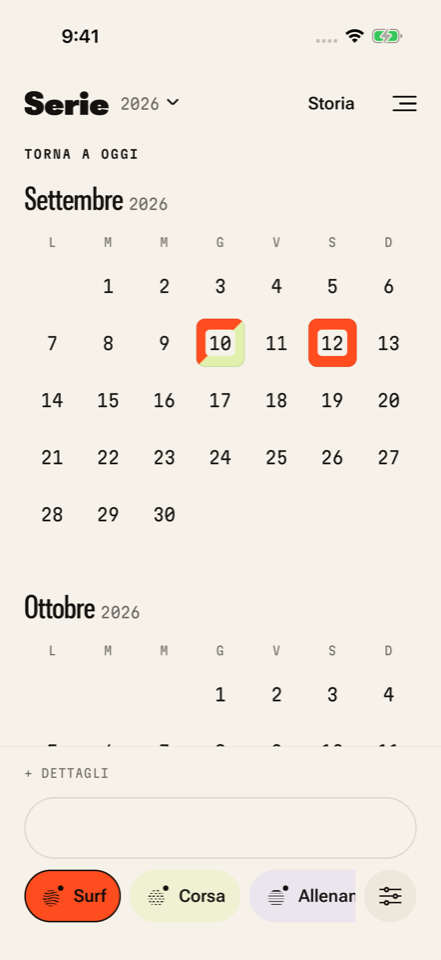

# Serie 1.1 — captured native screens

These are actual screenshots from the final Release app at source `429a8a4a18971e1f4f1b69e86033f3c4933164cd`, [run 38336957498](https://github.com/b8magic/ForFun/actions/runs/38336957498), on iPhone 17 Pro / iOS 26.5, Xcode 26.6 and Maestro 2.11.0. They show the automated test fixture, not preloaded user sessions.

The macOS runner resized its captured PNGs to a maximum dimension of 960 pixels for readable log previews. This folder preserves those exact bytes; hashes and original capture names are in [provenance.json](provenance.json). Full-size originals, video and test receipts are in the run's `smoke-test` artifact while its retention lasts.

| Capture | What it records |
| --- | --- |
| [Cream calendar](calendar-cream.png) | Compact vertical months and shared Surf/Corsa day after adding the second activity; the native pixel check verifies both visible colors in that same day. |
| [Notes with keyboard](notes-keyboard.png) | The actual Apply footer remains reachable above the multiline keyboard. |
| [Year mosaics](year-mosaics.png) | Twelve month mosaics in a populated year, with real category colors. |
| [Period preview](period-preview.png) | Four actual sessions across three active days, with honest unavailable duration. |
| [Dark restart](dark-restart.png) | Restored dark appearance, captured during the brief launch-image fade; native04 continues through period editing and returns to cream normally. |
| [Day details](day-detail.png) | Updated Corsa note and saved Livorno place after period metadata is deleted without deleting sessions. |

